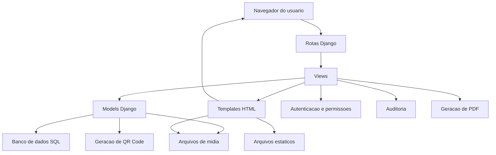
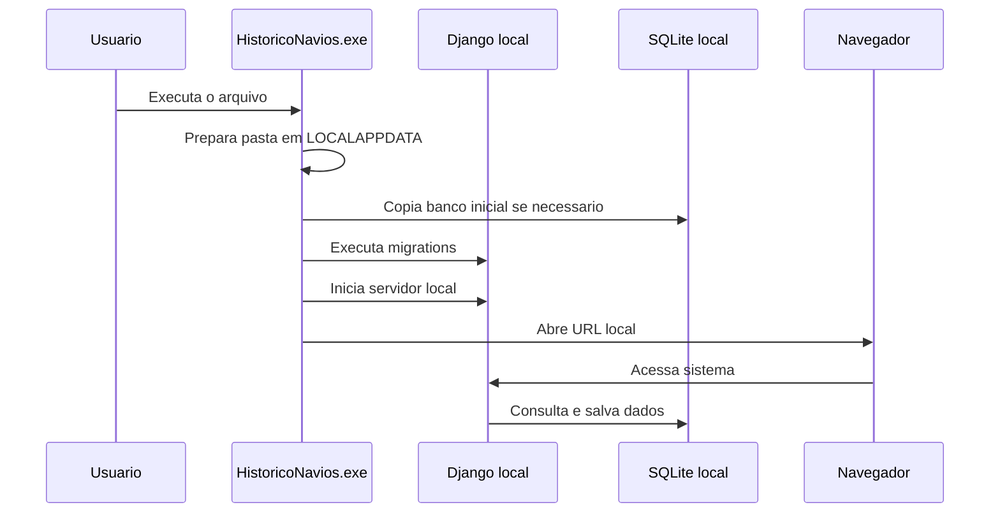

# Arquitetura do Sistema

## Visao geral

O sistema segue a arquitetura padrao do Django, baseada no padrao MTV:

- Model: representa as entidades e regras de persistencia.
- Template: apresenta as telas HTML ao usuario.
- View: processa requisicoes, aplica regras de negocio e retorna respostas.

## Diagrama de arquitetura

## Organizacao dos apps

| Pasta | Responsabilidade |
| --- | --- |
| `config` | Configuracoes gerais do Django, URLs principais, WSGI e ASGI. |
| `historico` | Cadastro de navios, midias, documentos, pesquisa, PDF, auditoria e permissoes. |
| `estoque` | Cadastro de colaboradores, equipamentos, certificacoes, estoque e QR Code. |
| `static` | Bibliotecas e arquivos estaticos utilizados em desenvolvimento. |
| `staticfiles` | Arquivos coletados para publicacao. |
| `media` | Uploads locais de documentos, fotos, videos e QR Codes. |

## Fluxo de uso local por executavel

## Decisoes tecnicas

- Django foi escolhido por integrar ORM, autenticacao, templates, admin e estrutura modular.
- SQLite foi mantido para facilitar instalacao local e operacao offline controlada.
- O uso de `DATABASE_URL` permite migrar para PostgreSQL em producao.
- Arquivos estaticos foram mantidos localmente para permitir uso offline.
- PyInstaller foi usado para distribuir o sistema como `.exe`, reduzindo dependencia de instalacao manual de Python no computador do usuario.
