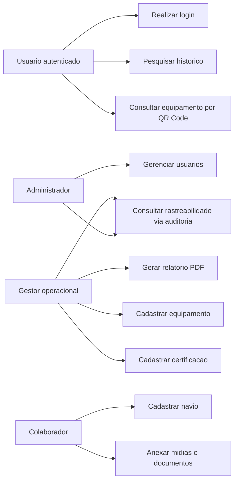

# Casos de Uso

## Atores

- Administrador: responsavel por usuarios e configuracoes administrativas.
- Gestor operacional: responsavel por acompanhar operacoes, validar registros e consultar historico.
- Colaborador: usuario que realiza cadastros e consultas no dia a dia.

## Diagrama de casos de uso

## UC01 - Realizar login

Ator principal: Usuario autenticado.

Fluxo principal:

1. O usuario acessa a tela inicial.
2. Informa suas credenciais.
3. O sistema valida os dados.
4. O sistema redireciona o usuario para o dashboard correspondente.

Resultado esperado: usuario autenticado e apto a acessar as funcionalidades permitidas.

## UC02 - Cadastrar navio

Ator principal: Colaborador ou gestor.

Fluxo principal:

1. O usuario acessa o cadastro de navio.
2. Informa dados como nome, armador, agencia, bordo, datas e volumes.
3. Anexa documentos ou midias, quando necessario.
4. O sistema salva o navio e vincula o usuario responsavel.
5. O sistema registra auditoria da criacao.

Resultado esperado: navio cadastrado com historico inicial disponivel para consulta.

## UC03 - Pesquisar historico de midias

Ator principal: Usuario autenticado.

Fluxo principal:

1. O usuario acessa a tela de pesquisa.
2. Informa filtros como navio, tipo de peca ou periodo.
3. O sistema consulta o banco de dados.
4. O sistema apresenta os resultados encontrados.

Resultado esperado: informacoes localizadas com rapidez para apoio operacional.

## UC04 - Gerar relatorio PDF

Ator principal: Gestor ou usuario autorizado.

Fluxo principal:

1. O usuario acessa uma midia ou documento.
2. Solicita a geracao do PDF.
3. O sistema monta o documento com os dados vinculados.
4. O arquivo e disponibilizado ao usuario.

Resultado esperado: relatorio gerado para registro ou compartilhamento.

## UC05 - Cadastrar equipamento e gerar QR Code

Ator principal: Gestor ou colaborador autorizado.

Fluxo principal:

1. O usuario acessa o cadastro de equipamento.
2. Informa identificador, tipo, localizacao, caracteristicas e quantidade.
3. O sistema salva o registro.
4. O sistema gera automaticamente um QR Code com o link de detalhe.

Resultado esperado: equipamento registrado e rastreavel por QR Code.

