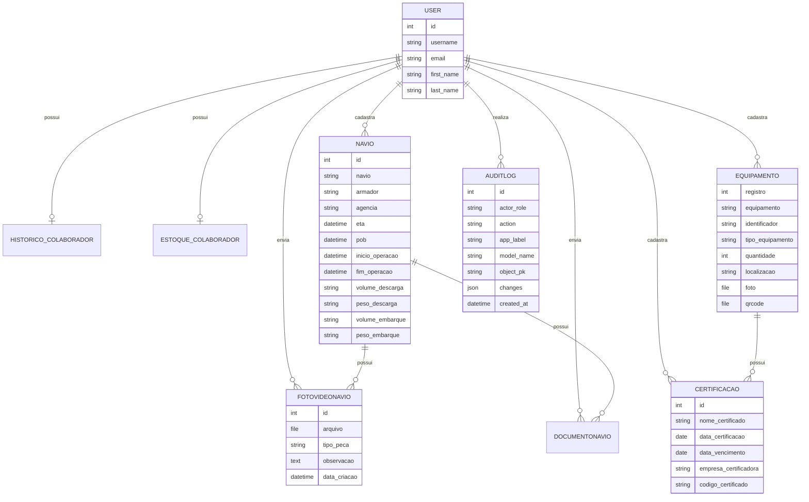

# Modelo de Dados

## Principais entidades

| Entidade | Finalidade |
| --- | --- |
| User | Usuario base do Django para autenticacao. |
| Colaborador | Perfil operacional do usuario, com matricula, CPF, cargo e contato. |
| Navio | Registro principal de navios e dados operacionais. |
| FotoVideoNavio | Midias vinculadas a um navio. |
| DocumentoNavio | Documentos vinculados a um navio. |
| AuditLog | Registro de auditoria de acoes realizadas no sistema. |
| Equipamento | Cadastro de equipamentos e materiais operacionais. |
| Certificacao | Certificacoes vinculadas a equipamentos. |

## Diagrama entidade-relacionamento simplificado

## Observacoes sobre persistencia

- O sistema utiliza o ORM do Django para manipular as tabelas.
- Em ambiente local, o banco padrao e SQLite.
- Para ambiente de producao, o projeto aceita configuracao por `DATABASE_URL`, permitindo PostgreSQL.
- Arquivos enviados pelo usuario sao armazenados na pasta de midia configurada por `MEDIA_ROOT`.

